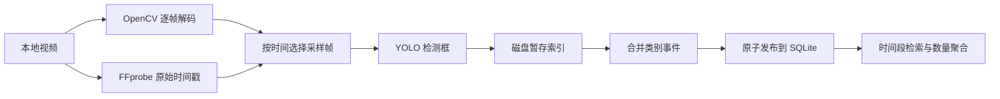

# SmartVision 学习路线

先阅读 README 的环境安装与运行命令。使用 Python 3.11、合适的 PyTorch CUDA/CPU 版本、FFmpeg/FFprobe、Node 和 npm；
模型由官方预训练权重获取，首次使用后缓存在 models。仓库不包含运行数据和 EXE，打包见 packaging/README_PACKAGING.md。

## 1. 视频与模型基础

依次阅读 backend/config.py、core/video_io.py、core/detector.py、core/analyzer.py、core/timestamps.py。
重点看流式读帧、资源释放、模型只加载一次、结构化 Detection，以及稀疏索引与逐帧标注输出的区别。
用 tests/test_core.py 和 tests/test_timestamp_tail.py 理解异常处理，不必先准备 GPU。

## 2. 从帧检测到可查询事件

阅读 services/indexing.py、services/events.py、database/repository.py、services/search.py 和 tests/test_indexing.py。



videos 保存视频元数据，detections 保存每个采样帧的检测框，events 保存类别出现时间段。
数量统计按帧数框再取事件内最大值，不把跨帧框数相加，也不代表不同人员的累计人数。

## 3. API、排队和取消

阅读 schemas/api.py、api/routes.py、services/tasks.py、database/api_repository.py 及 migration_v2/v3.sql。
API 返回 task_id 后立即结束请求，由前端轮询，不把 HTTP 请求保持到 YOLO 完成。

- queued/running 是活动状态；succeeded/failed/cancelled 是终态。
- cancel_requested 表示用户已请求停止，不等于工作者已经退出。
- 每个任务有独立取消令牌，检查点到达后抛出取消异常；工作线程继续处理后续任务。
- 发布前的取消检查与发布使用同一把锁；已开始提交的结果不能再被报告为取消成功。
- 暂存结果仅在完整成功后发布，停止/失败不会替换旧有效索引。

读 tests/test_counts_cancel.py 的可控测试：排队容量、推理期间取消、提交先后顺序、旧索引保留和备份迁移。

## 4. Vue 数据流

从 frontend/src/views/DashboardView.vue 开始，结合 api/、types/ 和 composables/useTaskPolling.ts。
再阅读 VideoUploader、VideoList、VideoPlayer、AnalysisPanel、TaskProgress、EventSearch、EventTimeline。
重点看 Fetch 的统一错误处理、AbortController、任务切换时丢弃旧响应、取消后的轮询终止和刷新恢复。

## 5. 运行验证

```powershell
# 项目根目录；需要先安装相应依赖。FFprobe/FFmpeg 集成测试需要 PATH 中存在工具。
.\.venv\Scripts\python.exe -m pytest -q
cd frontend
npm ci
npm run test:unit
npm run build
```

最新已验证：后端 101 项、前端 44 项，详见 COUNTS_CANCEL_VALIDATION.md。
主要单元测试通过模拟检测器覆盖业务，真实模型/EXE 验收则由 tests/validate_*.py 和 frontend/e2e 执行；
这些验收需要模型、媒体素材或既有验收数据，不保证在全新克隆后直接可用，也不把模拟结果当成真实推理。

## 6. Windows 发布

阅读 packaging/launcher.py、smartvision.spec、build_windows.ps1、verify_sources.py。
理解只读资源与 LOCALAPPDATA 用户数据分离、同源静态页面、独占端口、日志及正常退出。
构建后应从实际 EXE 验收；源码测试、EXE 文件存在、原生窗口点击和干净电脑兼容性是不同的验证项。

## 7. 阅读真实迭代

按 docs/ITERATIONS.md 的两个 git diff 查看 PTS 修复、数量统计与任务停止的具体修改。
第一至第四阶段使用验收文档回顾，未提供不存在的原始提交。后续目标跟踪、去重和剪辑目前尚未实现。
